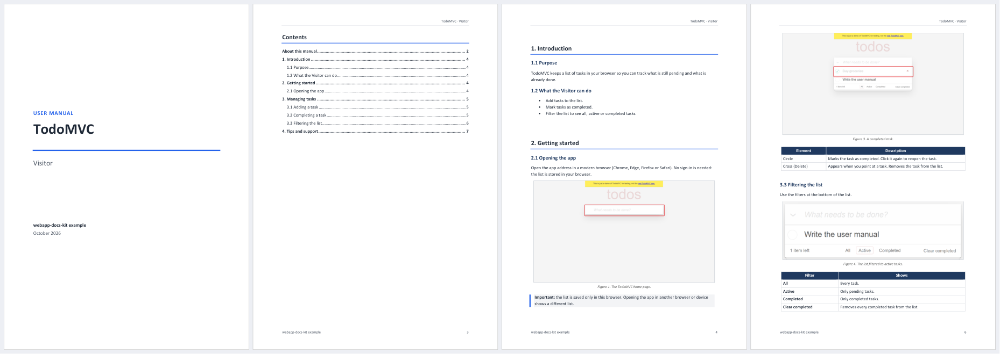
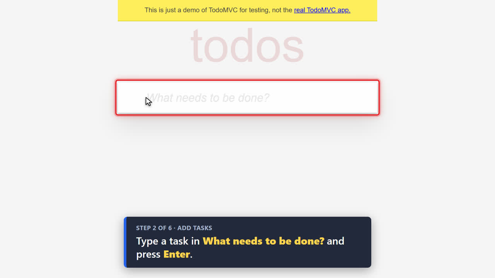

# webapp-docs-kit

**Agent skills that look at your web app the way users do.** Screenshot the
screens a change touches and catch what a green build misses, then turn the same
recorded walkthrough into a polished **PDF/DOCX user manual** and an **MP4 video
tutorial** for every role in your app.

Works with Claude Code, Codex, Gemini CLI, GitHub Copilot, Cursor, OpenCode and
any agent that reads [Agent Skills](https://agentskills.io) (`SKILL.md`).

[](LICENSE)
[](https://agentskills.io)
[](https://playwright.dev)

| Skill | What it does |
|---|---|
| [`visual-check`](skills/visual-check/SKILL.md) | Signs in with the right role, screenshots the screens affected by a change, **looks at them**, and reports JavaScript errors, console errors, HTTP ≥ 400 responses, blank pages and login redirects. |
| [`user-manual`](skills/user-manual/SKILL.md) | Writes one end-user manual per role (PDF + editable DOCX) with real screenshots, a cover, header/footer and an automatic table of contents. |
| [`video-tutorial`](skills/video-tutorial/SKILL.md) | Renders one 1920×1080 MP4 per role: the camera zooms into each field, a red box highlights it, a cursor moves to it and a caption explains the step. Includes `.srt` subtitles. |

<p align="center">
  <br>
  <em>A manual generated from the <a href="examples/todomvc">TodoMVC example</a> (<a href="https://github.com/IHanfoxI/webapp-docs-kit/releases/latest/download/manual-todomvc-visitor.pdf">download the PDF</a>).</em>
</p>
<p align="center">
  <br>
  <em>A frame of the matching video tutorial.</em>
</p>

---

## Contents

- [Installation](#installation)
  - [Claude Code](#claude-code) · [Codex](#codex) · [Gemini CLI](#gemini-cli) · [GitHub Copilot, Cursor, OpenCode and others](#github-copilot-cursor-opencode-and-others) · [Installer script](#installer-script-any-agent) · [Per project](#per-project-install)
- [Prerequisites](#prerequisites)
- [Set up a project](#set-up-a-project)
- [Usage](#usage)
- [Safety rules](#safety-rules)
- [What it runs, downloads, sends and stores](#what-it-runs-downloads-sends-and-stores)
- [How it works](#how-it-works)
- [Try the example](#try-the-example)
- [Troubleshooting](#troubleshooting)
- [Contributing](#contributing)

---

## Installation

> [!IMPORTANT]
> Install **all three skills** together. `user-manual` and `video-tutorial`
> reuse the scripts in `visual-check/scripts`, so they must sit side by side in
> the same skills folder. Every method below does that by default.

The first time a skill runs, the agent installs Playwright (`npm install`) and
downloads Chromium (~150 MB) if they are missing. You also need the
[prerequisites](#prerequisites) for the skills you use.

### Claude Code

This repository is a plugin marketplace. Inside Claude Code:

```text
/plugin marketplace add IHanfoxI/webapp-docs-kit
/plugin install webapp-docs-kit@webapp-docs-kit
```

Or from your shell:

```bash
claude plugin marketplace add IHanfoxI/webapp-docs-kit
claude plugin install webapp-docs-kit@webapp-docs-kit
```

Plugin skills are namespaced: `/webapp-docs-kit:visual-check`,
`/webapp-docs-kit:user-manual`, `/webapp-docs-kit:video-tutorial`. Claude also
picks them up on its own when you ask for "a user manual for the clerk role".
Update with `claude plugin update webapp-docs-kit@webapp-docs-kit`.

Prefer plain skills (`/visual-check` without a prefix)? Use the
[skills CLI](#github-copilot-cursor-opencode-and-others) with `-a claude-code`
or the [installer script](#installer-script-any-agent).

### Codex

The repository is also a Codex plugin marketplace:

```bash
codex plugin marketplace add IHanfoxI/webapp-docs-kit
```

Then open `/plugins` in Codex and install **Web App Docs Kit**. To install the
skills without the plugin wrapper, use the skills CLI:

```bash
npx skills@1.7.2 add IHanfoxI/webapp-docs-kit -a codex -g --skill '*'
```

Codex reads user skills from `~/.agents/skills/` and project skills from
`.agents/skills/`. Mention a skill with `$visual-check`, or just describe the task.

### Gemini CLI

```bash
gemini skills install https://github.com/IHanfoxI/webapp-docs-kit.git --path skills/visual-check
gemini skills install https://github.com/IHanfoxI/webapp-docs-kit.git --path skills/user-manual
gemini skills install https://github.com/IHanfoxI/webapp-docs-kit.git --path skills/video-tutorial
```

Add `--scope workspace` to install them for the current project only. Gemini
CLI reads `~/.gemini/skills/` and `~/.agents/skills/`.

### GitHub Copilot, Cursor, OpenCode and others

The [skills CLI](https://github.com/vercel-labs/skills) installs into 40+ agents
and detects the ones you have:

```bash
npx skills@1.7.2 add IHanfoxI/webapp-docs-kit --skill '*'          # current project
npx skills@1.7.2 add IHanfoxI/webapp-docs-kit --skill '*' -g       # your user, all projects
npx skills@1.7.2 add IHanfoxI/webapp-docs-kit --skill '*' -g -a github-copilot cursor opencode
```

| Agent | User folder | Project folder |
|---|---|---|
| Claude Code | `~/.claude/skills/` | `.claude/skills/` |
| Codex | `~/.agents/skills/` | `.agents/skills/` |
| Gemini CLI | `~/.gemini/skills/` or `~/.agents/skills/` | `.gemini/skills/` or `.agents/skills/` |
| GitHub Copilot | `~/.copilot/skills/` or `~/.agents/skills/` | `.github/skills/`, `.claude/skills/` or `.agents/skills/` |
| Cursor | `~/.cursor/skills/` | `.agents/skills/` |
| OpenCode | `~/.config/opencode/skills/` | `.agents/skills/` |

### Installer script (any agent)

Clone the repo and let the installer check the prerequisites, install
Playwright and Chromium, and link the skills into `~/.claude/skills`,
`~/.agents/skills` (Codex, Gemini CLI, Copilot, OpenCode…) and `~/.cursor/skills`
if Cursor is present. Links mean `git pull` updates every agent at once.

```bash
# Linux / macOS
git clone https://github.com/IHanfoxI/webapp-docs-kit.git ~/dev/webapp-docs-kit
~/dev/webapp-docs-kit/install.sh
```

```powershell
# Windows (PowerShell). Uses junctions: no admin rights needed.
git clone https://github.com/IHanfoxI/webapp-docs-kit.git $HOME\dev\webapp-docs-kit
powershell -ExecutionPolicy Bypass -File $HOME\dev\webapp-docs-kit\install.ps1
```

Uninstall with `install.sh --uninstall` / `install.ps1 -Uninstall` (removes
only the links).

### Per-project install

To version the skills with a project so the whole team gets them:

```bash
~/dev/webapp-docs-kit/install.sh --project ~/code/my-app
```

```powershell
powershell -ExecutionPolicy Bypass -File $HOME\dev\webapp-docs-kit\install.ps1 -Project C:\code\my-app
```

This copies the skills into `my-app/.claude/skills/` and `my-app/.agents/skills/`.
Add `**/node_modules/` to the project's `.gitignore`.

> [!NOTE]
> These skills drive a real browser against an app running on your machine or
> your network, so they need an agent with a local shell. They do not work in
> claude.ai or ChatGPT web chats.

## Prerequisites

| Tool | Needed by |
|---|---|
| Node.js 18+ | all skills |
| ffmpeg | `video-tutorial` |
| Python 3.8+ (standard library only) | `user-manual` |
| LibreOffice, or Microsoft Word on Windows | `user-manual` (table of contents and PDF) |
| Poppler (`pdftoppm`) | `user-manual` (page review) |

One-line installs for Linux, macOS and Windows are in
[docs/prerequisites.md](docs/prerequisites.md). If you only use
`/visual-check`, Node.js is enough.

## Set up a project

Do this once per app. If you skip it, the agent asks for what it needs the
first time you use a skill.

### 1. Test credentials

Each role you check or document needs a **test user**, never a real one. Put
their credentials in environment variables, stored **outside any repository**,
for example `~/.config/webapp-docs-kit/<project>.env`, and load them before
starting the agent:

```bash
source ~/.config/webapp-docs-kit/acme-orders.env && claude
```

In an open Claude Code session you can run `! source ~/.config/webapp-docs-kit/acme-orders.env`.
PowerShell and Windows details: [docs/prerequisites.md](docs/prerequisites.md#test-credentials).

### 2. `docs/webapp-docs.json`

The agent writes this file from your code (routes, auth config, menus). You can
review it or write it yourself:

```json
{
  "app": "Acme Orders",
  "organization": "Acme Corp — Operations",
  "support": "Questions? help@example.com",
  "baseUrl": "http://localhost:3000",
  "login": {
    "path": "/login",
    "usernameSelector": "input[name='email']",
    "passwordSelector": "input[name='password']",
    "submitSelector": "button[type='submit']",
    "afterLoginSelector": "nav.main-menu"
  },
  "hide": ["#dev-toolbar", ".cookie-banner"],
  "redact": ["td.col-email", "td.col-customer"],
  "roles": {
    "clerk": { "name": "Order Clerk",
               "credentialsEnv": { "username": "ACME_CLERK_USER", "password": "ACME_CLERK_PASS" } }
  }
}
```

`credentialsEnv` holds the **names** of the variables, not the credentials.
`redact` lists what gets blurred in every screenshot (names, emails, IDs). All
options, including logo, colors and caption translations for videos, are in
[configuration.md](skills/visual-check/references/configuration.md).

## Usage

The examples use plain skill names. With the Claude Code plugin, prefix them
(`/webapp-docs-kit:user-manual`); in Codex, use `$user-manual`. You can also
just describe what you want.

### `/visual-check` — verify UI changes

Use it when you finish a change to anything users see, or to see how a screen
looks for a given role. Agents can run it on their own after UI changes.

```text
/visual-check /orders/new with the clerk role
/visual-check the new filter on the reports page
/visual-check make sure the confirmation dialog is no longer transparent
```

The agent picks the affected views and roles, signs in with the test user,
reproduces the state (opens panels, applies filters, opens dialogs), takes the
screenshot, **opens it**, and reports per screen: path, role, whether it looks
right, problems found, and the screenshot path (in
`~/.cache/webapp-docs-kit/screenshots/`, outside your repo).

### `/user-manual` — one manual per role

```text
/user-manual clerk
/user-manual all
/user-manual manager, in Spanish
```

1. Finds the roles and their screens in the code.
2. Writes a **walkthrough** per role (`docs/manuals/<role>/walkthrough.json`).
3. Runs it against the app and takes the screenshots, blurring personal data
   and cropping dialogs.
4. Writes the text following a consistent [style guide](skills/user-manual/references/manual-style.md):
   preface, introduction, getting started, one section per task, tips and support.
5. Builds the DOCX on a neutral template (generated by [build_template.py](skills/user-manual/scripts/build_template.py), no logos)
   and the PDF with an up-to-date table of contents.
6. Reviews every PDF page before handing it over.

Output in `docs/manuals/<role>/`: `manual-<app>-<role>.pdf`, the editable
`.docx`, `manual.md`, `walkthrough.json` and `screenshots/`. When the app
changes, rerun the same walkthrough to refresh screenshots and PDF.

**Branding the template:** regenerate it with your colors
(`python3 skills/user-manual/scripts/build_template.py my-template.docx --primary 0F766E --accent F59E0B --letter`),
or open it in Word/LibreOffice, add your logo and fonts, keep the `{{...}}`
markers, and ask the agent to use it.

### `/video-tutorial` — one video per role

```text
/video-tutorial clerk
/video-tutorial all
/video-tutorial clerk with music ~/Music/licensed-track.mp3
```

Uses the same walkthrough as the manual (or creates it), records every state on
a 1920×1080 screen at 2× density, reviews a contact sheet, and renders:

- a cover card, a title card per scene and a closing card with the support contact;
- for every step: **zoom** into the field, **red box**, **cursor** and a **caption**;
- `video-<app>-<role>.mp4`, its `.srt` subtitles, and `-music.mp4` if you pass a track.

Videos go to `~/Videos/walkthroughs/<app>/<role>/` and never into the repository.
There is no bundled music: only use tracks you are licensed to use.

## Safety rules

- **Never point it at production.** Local, dev or staging only, with test users.
- **Credentials never go into repository files or the chat.** Only variable names do.
- **Nothing changes data.** Buttons such as Save, Delete, Submit, Send, Sign or
  Pay are refused. Manuals and videos show them highlighted with
  `"simulate": true` but never click them. Clicking them needs explicit
  authorization, case by case, in a test environment (`"allowChange": true`).
  Add labels in other languages with `protectedLabels`.
- **Personal data is always blurred** in screenshots that leave your machine.
- If a screen looks wrong, that is a bug in the app. Fix the app; do not hide
  it in the manual or the video.

## What it runs, downloads, sends and stores

Everything runs locally. There is no telemetry, no account and no server of ours.

| | Details |
|---|---|
| **Runs** | Node.js scripts in `skills/*/scripts` (Playwright driving headless Chromium), Python scripts using only the standard library, `ffmpeg`, `pdftoppm`, and LibreOffice (UNO) or Microsoft Word (COM, Windows) to export PDFs. The agent runs them when a skill asks it to. |
| **Downloads** | Once, on first use: the npm package `playwright-core` at the exact version pinned in [`package.json`](skills/visual-check/scripts/package.json) and [`package-lock.json`](skills/visual-check/scripts/package-lock.json) (from the npm registry), and the Chromium build that Playwright installs (from Playwright's CDN). Nothing else. |
| **Network** | The browser only opens the `baseUrl` you configure (your local, dev or staging app) and whatever that app loads itself. The scripts do not contact any other host. |
| **Credentials** | Read from the environment variables you name in `credentialsEnv` and typed only into your app's own login form at `baseUrl`. They are never written to disk, logged or sent anywhere else. Use test users. |
| **Personal data** | Screenshots may contain whatever your app shows. Selectors in `redact` are blurred before every capture. Images stay on your machine. |
| **Writes** | In your project: `docs/webapp-docs.json` and `docs/manuals/<role>/` (walkthrough, Markdown, screenshots, DOCX, PDF). Outside it: `~/.cache/webapp-docs-kit/` (screenshots, video working files, the generated Word template) and the video output folder (default `~/Videos/walkthroughs/`). The skills never modify your app's data: buttons that save, delete, submit, send, sign or pay are refused unless you explicitly allow them. |

## How it works

```
skills/
├── visual-check/
│   ├── SKILL.md
│   ├── references/configuration.md      # docs/webapp-docs.json reference
│   ├── references/capture-pitfalls.md   # selectors, SPAs, animations, JSF/PrimeFaces
│   └── scripts/                         # shared by all three skills
│       ├── common.js                    # config, browser, login, blur, data-change guard
│       ├── walkthrough.js               # runs walkthroughs (manual and video)
│       └── check.js                     # screenshot + diagnostics for one screen
├── user-manual/
│   ├── SKILL.md
│   ├── references/                      # style guide, Markdown subset, walkthrough format
│   └── scripts/
│       ├── capture.js                   # walkthrough screenshots for the manual
│       ├── build_manual.py              # Markdown → DOCX on the template
│       ├── build_template.py            # neutral template, no logos (colors, A4/Letter)
│       └── to_pdf.py                    # refreshes the TOC and exports the PDF
└── video-tutorial/
    ├── SKILL.md
    ├── references/video-style.md
    └── scripts/
        ├── record.js                    # app states at 3840×2160
        └── compose.js                   # frame-by-frame compositing + ffmpeg
```

**One walkthrough, two outputs.** A walkthrough is a JSON list of scenes and
steps (`go`, `click`, `type`, `highlight`), each with an imperative `text`. The
manual takes screenshots from it; the video turns the same steps into camera
moves and captions. Format: [walkthrough-format.md](skills/user-manual/references/walkthrough-format.md).

**The video is not a screencast.** `record.js` captures every state (before and
after each action, and a few frames while typing) at 2× density. `compose.js`
draws each frame in an HTML page (zoomed screenshot, box, cursor, caption,
cards) and pipes it to ffmpeg (H.264, 30 fps, `yuv420p`). Server wait times
never appear, zooms up to 2.2× stay sharp, and the same walkthrough always
produces the same video. A one-minute video renders in under a minute.

**The manual is real Word.** `build_manual.py` fills the template's markers
using only the Python standard library. Styles are found by their built-in
names, so templates saved from Word in any language work. `to_pdf.py` recomputes
the table of contents with LibreOffice (UNO) or Microsoft Word (COM);
`soffice --convert-to pdf` alone would leave stale page numbers.

**Files outside your repository:**

| Path | Contents |
|---|---|
| `~/.config/webapp-docs-kit/<project>.env` | Test credentials (readable only by you) |
| `~/.cache/webapp-docs-kit/screenshots/` | `/visual-check` screenshots |
| `~/.cache/webapp-docs-kit/video/` | Video working files (safe to delete) |
| `~/.cache/webapp-docs-kit/manual-template.docx` | Default Word template, generated on first use |
| `~/Videos/walkthroughs/` | Delivered videos |

## Try the example

[`examples/todomvc`](examples/todomvc) documents the public
[Playwright TodoMVC demo](https://demo.playwright.dev/todomvc), no login needed.
From that folder, ask your agent for `/user-manual visitor` or
`/video-tutorial visitor`, or run the scripts by hand:

```bash
cd examples/todomvc
K=../../skills
node $K/visual-check/scripts/check.js "/#/" --no-login
node $K/user-manual/scripts/capture.js docs/webapp-docs.json docs/manuals/visitor/walkthrough.json
cd docs/manuals
python3 ../../$K/user-manual/scripts/build_manual.py visitor/manual.md visitor/manual-todomvc-visitor.docx
python3 ../../$K/user-manual/scripts/to_pdf.py visitor/manual-todomvc-visitor.docx
cd ../..
node $K/video-tutorial/scripts/record.js docs/webapp-docs.json docs/manuals/visitor/walkthrough.json
node $K/video-tutorial/scripts/compose.js ~/.cache/webapp-docs-kit/video/todomvc/visitor/timeline.json out/video.mp4 --preview
node $K/video-tutorial/scripts/compose.js ~/.cache/webapp-docs-kit/video/todomvc/visitor/timeline.json out/video.mp4
```

(Run `npm install` in `skills/visual-check/scripts` first if you did not use an installer.
In Git Bash on Windows, prefix commands that take a `/path` with `MSYS_NO_PATHCONV=1`.)

## Troubleshooting

| Symptom | Likely cause |
|---|---|
| `environment variable X (role Y) is not set` | The credentials were not loaded in the agent's session. See [Test credentials](#1-test-credentials). |
| `selector not visible` | Wrong or prefixed selector. Run `check.js <path> --html` and see [capture-pitfalls.md](skills/visual-check/references/capture-pitfalls.md). |
| `... looks like it changes data` | The data-change guard. Use `"simulate": true` in the walkthrough. |
| Blank page with HTTP 200 | The server failed while rendering. Check its log. |
| Half-transparent dialog in the screenshot | A fade animation. Add `"wait"` to the step or `--wait` to `check.js`. |
| `the uno module is missing` | Linux: `sudo apt install python3-uno`. Windows/macOS: install LibreOffice (or use Word on Windows). |
| PDF table of contents with old page numbers | The PDF was exported without `to_pdf.py`. |
| `python` opens the Microsoft Store | Turn off the `python.exe` app execution alias ([details](docs/prerequisites.md#windows-1011)). |
| `spawn ffmpeg ENOENT` | ffmpeg is not installed or not on `PATH`. |
| Git Bash turns `/#/` into `C:/Program Files/Git/#/` | Prefix the command with `MSYS_NO_PATHCONV=1`. |

## Contributing

Issues and pull requests are welcome.

- Keep `SKILL.md` files short and imperative; move details to `references/`.
- New skills go in `skills/<name>/SKILL.md` with `name` (matching the folder),
  `description` (what it does **and** when to use it) and optionally
  `argument-hint`. Reuse `../visual-check/scripts/common.js` for config, browser
  and login. Add the skill to `SKILLS` in `install.sh` and `install.ps1`.
- Test against a real app (or `examples/todomvc`) and open every generated
  image before sending a PR.
- Maintainers: release and directory listing steps are in [docs/publishing.md](docs/publishing.md).

## License

[MIT](LICENSE) © Diego Calderón C.
