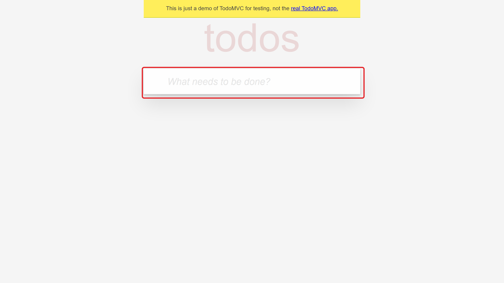
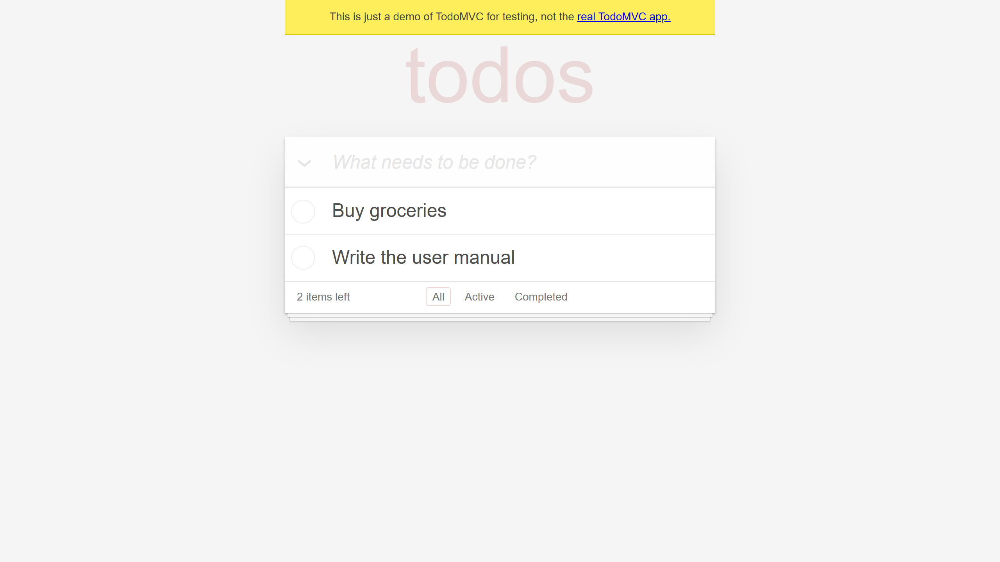
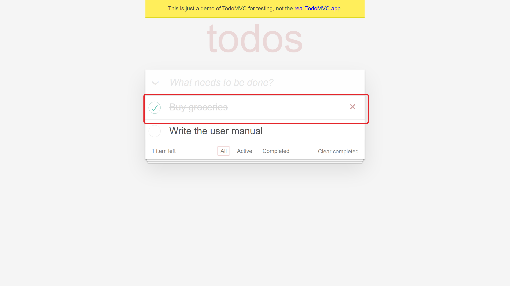
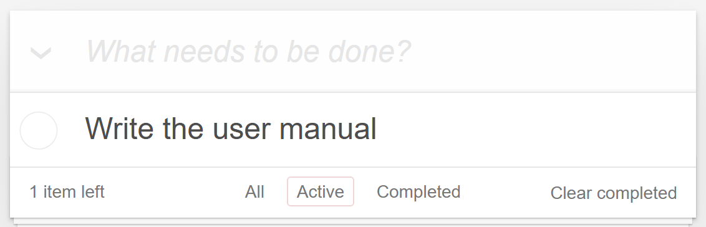

This manual explains how to use **TodoMVC** to keep a simple to-do list. It
covers adding tasks, completing them and filtering the list.

It is an example generated with webapp-docs-kit against the public Playwright
demo. Screenshots are illustrative; in a real manual any personal data is blurred.

# Introduction

## Purpose

TodoMVC keeps a list of tasks in your browser so you can track what is still
pending and what is already done.

## What you can do

- Add tasks to the list.
- Mark tasks as completed.
- Filter the list to see all, active or completed tasks.

# Getting started

## Opening the app

Open the app address in a modern browser (Chrome, Edge, Firefox or Safari). No
sign-in is needed: the list is stored in your browser.

> **Important:** the list is saved only in this browser. Opening the app in another browser or device shows a different list.

# Managing tasks

## Adding a task

a) Click the **What needs to be done?** box.
b) Type the task.
c) Press **Enter**.

The task appears at the top of the list.

## Completing a task

Click the **circle** to the left of a task. The task is crossed out and the
**items left** counter goes down.

| Element | Description |
|---|---|
| Circle | Marks the task as completed. Click it again to reopen the task. |
| Cross (Delete) | Appears when you point at a task. Removes the task from the list. |

## Filtering the list

Use the filters at the bottom of the list.

| Filter | Shows |
|---|---|
| **All** | Every task. |
| **Active** | Only pending tasks. |
| **Completed** | Only completed tasks. |
| **Clear completed** | Removes every completed task from the list. |

# Tips and support

- Keep each task short and specific.
- Clear completed tasks from time to time to keep the list readable.

For questions, contact your help desk.
